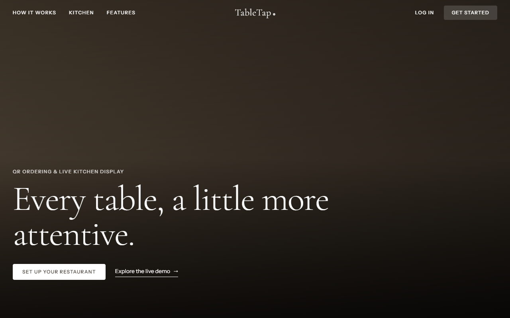

  

  

  
  
  
  

  
  
  
  
  

  

---

### 🌟 Highlights

- 🏆 **Merged upstream:** a bug fix to IBM's [docling](https://github.com/docling-project/docling), approved by a maintainer and merged 2026-11-24 ([#5462](https://github.com/docling-project/docling/pull/5462)).
- 🛠️ **Built alone:** three Go tools that test whether AI infrastructure holds up when things fail, each with CI that shows the tool catches bugs planted on purpose.
- 🧾 **Honest about limits:** every project below says what is verified and what is not yet.

### ✨ Featured work

<table>
<tr>
<td width="50%" valign="top">

<h4>💸 <a href="https://github.com/NAMAN-VERMA-02/capproof">capproof</a></h4>
Does your LLM spend cap hold when things go wrong? Fault-injection tests checked against an independent billing oracle. 
Go · fault injection · LLM gateways · v0.1.0
</td>
<td width="50%" valign="top">

<h4>🎞️ <a href="https://github.com/NAMAN-VERMA-02/agentreplay">agentreplay</a></h4>
Record, replay and regression-test tool-using AI agents (LLM + MCP) offline, with verdicts CI can use. 
Go · AI agents · MCP · regression testing
</td>
</tr>
<tr>
<td width="50%" valign="top">

<h4>🛡️ <a href="https://github.com/NAMAN-VERMA-02/mcpfuzz">mcpfuzz</a></h4>
Scan MCP servers for protocol conformance bugs and security issues, with evidence-based verdicts. 
Go · Docker · MCP · security testing
</td>
<td width="50%" valign="top">

<h4>🍽️ <a href="https://github.com/NAMAN-VERMA-02/tabletap">TableTap</a> · <a href="https://tabletap-blush-phi.vercel.app">live</a></h4>
QR restaurant ordering with a real-time kitchen display. Solo project. 
React · Express · MongoDB · Socket.io
</td>
</tr>
</table>

🖥️ Terminal cards are real runs of each tool's one-minute demo, trimmed to fit.

### 🔬 Flagship work: does AI infrastructure hold up when things fail?

Three Go tools I built alone. All three are **experimental**: each one is proven in CI against systems I wrote, not yet against real providers or outside users.

#### 💸 [capproof](https://github.com/NAMAN-VERMA-02/capproof)
   

Tests whether an LLM gateway's spend cap holds under concurrency, dropped streams and malformed usage data, checking results against a mock provider that keeps its own bill, so it never trusts the gateway's numbers. Ships `capd`, a reference gateway that reserves each call's worst-case cost in a durable ledger before forwarding.

> ✅ **Verified:** CI shows the suite tells a naive gateway (BREACHED) from a strict one (HELD); if it couldn't, no other result would mean anything. 
> ⏳ **Not yet verified:** a real provider's billing.

#### 🎞️ [agentreplay](https://github.com/NAMAN-VERMA-02/agentreplay)
  

Records what a tool-using agent sends to its LLM and MCP servers, replays the run offline, and tests a changed agent against the recorded tool results, with a SAME / CHANGED verdict and a CI exit code. Checks structure, not semantic correctness.

> ✅ **Verified:** catches regressions I planted in a demo agent run against a scripted model and a fake MCP server. 
> ⏳ **Not yet verified:** real providers and real agents.

#### 🛡️ [mcpfuzz](https://github.com/NAMAN-VERMA-02/mcpfuzz)
   

Checks MCP servers for protocol conformance bugs and, in an isolated Docker run, for path traversal (a canary from outside the allowed root must come back) and shell injection (an injected command must create a marker file).

> ✅ **Verified:** CI flags each planted bug in a deliberately vulnerable server and passes its fixed twin, which differs only at those bugs. 
> ⏳ **Not yet verified:** any third-party MCP server.

### 🤝 Pull requests to other projects

**✅ Merged**
- 📄 **[docling](https://github.com/docling-project/docling)** (IBM's document conversion library): [#5462](https://github.com/docling-project/docling/pull/5462) drops malformed link targets instead of turning them into broken `https:/` paths in the Markdown, HTML, AsciiDoc and JATS backends ([#5448](https://github.com/docling-project/docling/issues/5448)), through one shared `parse_hyperlink` helper with tests. Approved by a maintainer and merged 2026-11-24.
- 🏠 **Roof** (Mansi Verma's warranty vault, college project): [#1](https://github.com/mansiverma897993/Roof/pull/1) streaming uploads, sign-in lockout, quotas, account controls. Merged 2026-11-19.
- 🛒 **SELLABLE** (team project I'm a member of): [#22](https://github.com/HarshDubey23/SELLABLE/pull/22) audit log, LlamaIndex example, client config. Merged 2026-11-12.

**⏳ Open, not merged yet**
- 🛒 **SELLABLE:** [#21](https://github.com/HarshDubey23/SELLABLE/pull/21) plural matching, ruff, inspect CLI.
- 🕵️ **NetraShield:** [#21](https://github.com/Gauravkkaushal/Browser-s-Agent/pull/21) on-device image redaction, face/QR masking, send guardrails.

My copies of SELLABLE, Browser-s-Agent and Roof on this profile are forks used to send my PRs; the projects belong to their teams.

### 🏅 Achievements

| | Achievement | Details |
|:-:|---|---|
| 🏆 | **Open source: merged into IBM's docling** | Fix [#5462](https://github.com/docling-project/docling/pull/5462) approved by a maintainer and merged 2026-11-24, plus merged PRs to [Roof](https://github.com/mansiverma897993/Roof/pull/1) and [SELLABLE](https://github.com/HarshDubey23/SELLABLE/pull/22) |
| 🇮🇳 | **Smart India Hackathon: cleared the institute round, 2×** | Team selected at KIET's internal SIH round in two separate years |
| 💡 | **InnTech: selected at the departmental level** | Project selected in the department round |
| 🎤 | **CodeX 3.0 Hack Arena (Hackingly × PIET, Oct 2026)** | Built Abhed, an accountability layer for AI agents (PS5: AI Agent Governance), and demoed it on the main stage |
| 🧠 | **Meta × Scaler OpenEnv Hackathon (2026)** | Built an inventory replenishment environment for reinforcement-learning agents |
| 🌉 | **SETU hackathon (team of 6)** | Built the federated college node, round-2 architecture docs and the privacy probe |
| 🇯🇵 | **JLPT N5** | Passed the Japanese-Language Proficiency Test, level N5 |
| 📜 | **Infosys Springboard (Nov 2025)** | Certifications: Introduction to NoSQL Databases · Spring 5 in 7 Days |
| 🙋 | **Event volunteer** | Helped run a local event as a volunteer |
| 🎓 | **B.Tech CS, KIET (2024–2028)** | CGPA 8.3 / 10 |

### 🗂️ Other projects

| Project | Focus | Status | Evidence |
|---|---|---|---|
| 🧪 [ScamCheck](https://github.com/NAMAN-VERMA-02/scamcheck) | English and Hinglish scam detection | Research, synthetic data only | Baselines B0–B4 with confidence intervals, 14-transform adversarial lab. Reports its failures: the rule engine fell from 9/12 to 4/16 on another author's messages. |
| 🌉 [SETU](https://github.com/NAMAN-VERMA-02/setu) | Federated, privacy-preserving alumni network | Hackathon team project, 6 contributors · [live](https://setu-live-five.vercel.app) | **My part:** the college node (`node/`), round-2 architecture docs and the privacy probe. |
| 🍽️ [TableTap](https://github.com/NAMAN-VERMA-02/tabletap) | QR restaurant ordering with a real-time kitchen display | Solo project · [live](https://tabletap-blush-phi.vercel.app) | 51 API and real-time tests against in-memory MongoDB in CI. |
| 🛒 [SELLABLE](https://github.com/HarshDubey23/SELLABLE) | Security gateway and remote MCP server for AI commerce | Team project (Harsh Dubey's repo), I'm a member | **My part:** [#21](https://github.com/HarshDubey23/SELLABLE/pull/21) plural matching, ruff, inspect CLI · [#22](https://github.com/HarshDubey23/SELLABLE/pull/22) audit log, LlamaIndex example, client config. #22 merged; #21 open, not merged yet. |
| 🕵️ [NetraShield](https://github.com/Gauravkkaushal/Browser-s-Agent) | Privacy-preserving browser agent (SIH problem 26171) | SIH team project, I'm a member | **My part:** [#21](https://github.com/Gauravkkaushal/Browser-s-Agent/pull/21) on-device image redaction, face/QR masking, send guardrails. Open, not merged yet. |

### 🧰 Toolbox

  <picture>
    <source media="(prefers-color-scheme: dark)" srcset="https://skillicons.dev/icons?i=go,py,fastapi,ts,js,nodejs,express,react,nextjs,tailwind,mongodb,postgres,supabase,docker,githubactions,vercel,git,cpp,java&perline=10&theme=dark">
    
  </picture>

### ⚡ Recently active

<!--RECENT:START-->
- 🔨 **[capproof](https://github.com/NAMAN-VERMA-02/capproof)**: Does your LLM spend cap hold when things go wrong? Fault-injection tests with an independent billing oracle. · pushed 2026-11-25
- 🔨 **[clipmind](https://github.com/NAMAN-VERMA-02/clipmind)**: Clipboard history for Windows you search by meaning. Never stores secrets, encrypted behind Windows Hello, zero network code. · pushed 2026-11-23
- 🔨 **[mcpfuzz](https://github.com/NAMAN-VERMA-02/mcpfuzz)**: Scan MCP servers for protocol conformance bugs and security issues, with evidence-based verdicts · pushed 2026-11-22
- 🔨 **[mossling](https://github.com/NAMAN-VERMA-02/mossling)**: A cozy creature island in the browser: walk around, pet and feed cute creatures, make friends · pushed 2026-11-10
- 🔨 **[wave](https://github.com/NAMAN-VERMA-02/wave)**: Control any video with hand gestures via your webcam. Chrome extension, 100% on-device. · pushed 2026-11-10
<!--RECENT:END-->

### 📊 GitHub analytics

  

🔄 Regenerated every day from the GitHub API by a workflow in this repo. "PRs merged by other maintainers" counts only PRs someone else merged.

### 📈 Contribution activity

  <picture>
    <source media="(prefers-color-scheme: dark)" srcset="https://github-readme-activity-graph.vercel.app/graph?username=NAMAN-VERMA-02&bg_color=0d1117&color=8b949e&line=58a6ff&point=e6edf3&area=true&area_color=58a6ff&hide_border=true&custom_title=Contributions%20in%20the%20last%2031%20days">
    
  </picture>

<table>
<tr>
<td valign="top" width="50%">

### 🎯 Engineering interests

- 🏗️ Backend architecture and API design
- 🌐 Distributed systems and data consistency
- 🤖 AI agent infrastructure and evaluation
- 🔐 Application security and protocol testing
- 📊 Automated testing and reproducible benchmarks

</td>
<td valign="top" width="50%">

### 📐 Engineering principles

- 🔁 Reproducible results over unsupported claims.
- 📏 Explicit limitations over inflated metrics.
- 💥 Tests that verify failure modes, not just happy paths.
- 🧭 Clear ownership and contribution boundaries.
- 🛡️ Security and correctness as design requirements.

</td>
</tr>
</table>

  

